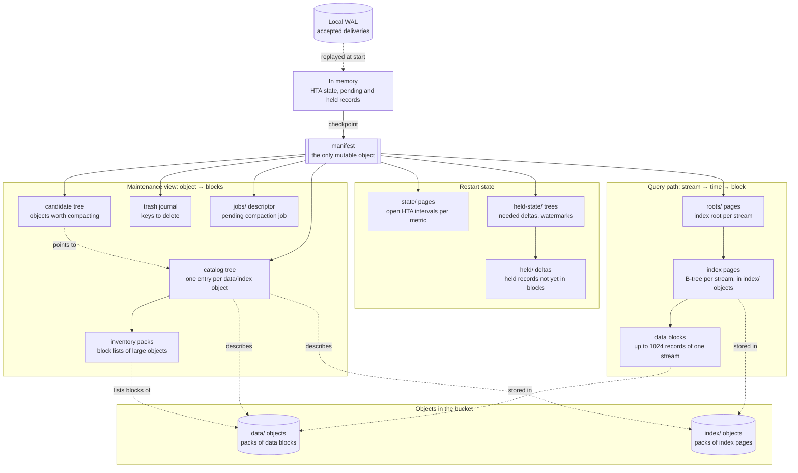

# How the data structures fit together

This page shows the database's data structures in one picture: which
structure refers to which, why each exists, and which operation reads or
writes it. [Storage layout](storage-layout.md) describes the object formats
in detail.

## Overview

Solid arrows are references by address (object key, offset, length,
SHA-256). Dotted arrows show what a structure stores or describes. Everything
except `manifest` is immutable: a change writes new objects and finally
replaces `manifest` with one conditional PUT. That PUT is the commit point.

## The layers

**1. Blocks and objects (the data).** A *data block* holds up to 1024
records of one *stream*, which is one metric and one HTA level. Index pages
are blocks too. Blocks are packed into objects of up to
`compaction_output_object_bytes` (4 MiB), so a checkpoint or job needs few
PUTs. An object can hold blocks of many streams. A query never reads an
object as a whole, only the byte range of one block, or of several adjacent
blocks of the same stream.

**2. Index (answers "which blocks hold stream S between t1 and t2?").** Each
stream has its own copy-on-write B-tree of index pages, with 64 entries per
page. A leaf entry names a block: first and last time, record count,
address, and the aggregate of its records. An inner entry names a child page
with the sum of its aggregates, so a single aggregate over a long window
needs only the pages along its borders. The roots of all trees are kept in
`roots/` pages, hash-partitioned by metric, and the manifest points to their
directory. Appending to a stream rewrites only the rightmost path of its
tree.

**3. Catalog (answers "what lives in object O, and how much of it?").** It
is the reverse direction of the index. For every data and index object it
records size, live bytes and the list of blocks still referenced. Without it,
finding out what is still alive in an object would mean walking all stream
indexes. Compaction uses it to choose objects to rewrite. Garbage collection
uses it to find objects without live blocks. The catalog is itself a
copy-on-write tree, keyed by object. An object with more than 128 blocks
keeps its block list in separate *inventory packs* referenced by its catalog
entry, so a leaf of the tree stays small. The *candidate tree* is an excerpt
of the catalog: objects that are small, have dead bytes or contain partial
blocks, ranked by dead fraction.

**4. Restart state (what has not reached blocks yet).** `state/` pages hold
the open HTA intervals of every metric, so aggregation continues seamlessly
after a restart. *Held records* are records a stream keeps in memory until
it fills a block or reaches `hold_max_age_seconds`. Every checkpoint saves
them as `held/` deltas, so they survive a restart without being written as
small blocks. `held-state/` trees list the deltas that are still needed and,
per stream, how far it has been written to blocks.

**5. Lifecycle structures.** The *trash journal* lists keys to delete. Garbage
collection deletes them once no running query pins an older manifest
generation. A `jobs/` descriptor names the inputs and output prefixes of a
pending compaction job, so an interrupted job can be fenced and its partial
outputs removed.

**Outside the bucket.** The local *WAL* holds every accepted delivery until a
checkpoint has stored it; a delivery is acknowledged only after its fsync.
In memory, the engine keeps the HTA state, the pending records of the next
checkpoint and the held records. Queries read these together with the
bucket, so new samples are visible immediately.

## The path of one block

1. **Ingest.** A delivery is appended to the WAL and fsynced. HTA aggregation
   turns its samples into raw and aggregate records, which become pending
   records of their streams.
2. **Checkpoint.** Full blocks (and old partial ones) are encoded and packed
   into a new `data/` object. The checkpoint then:
   - extends each stream's index (new pages in an `index/` object, new roots
     in `roots/` pages);
   - adds the new objects to the catalog with their block lists, and marks
     index pages it replaced as dead in the catalog entries of their old
     objects;
   - updates the candidate tree;
   - writes held records as a `held/` delta and the changed `state/` pages;
   - replaces `manifest` and releases the WAL segments it covers.
3. **Merge.** Partial blocks of a stream are rewritten into full blocks.
4. **Repack.** A small or partly dead object is rewritten together with the
   due merges of its streams' sections, into a nearly full object. The index
   entries of moved blocks get new addresses. The old object loses those
   blocks in its catalog entry; the new object gets an entry.
5. **Deletion.** An object without live blocks leaves the catalog and goes to
   the trash journal. Garbage collection deletes it.

## Which operation touches which structure

R = reads, W = writes new objects or versions, – = not involved.

| Operation | WAL | memory | manifest | roots/ + index | data blocks | state/ | held/ + held-state/ | catalog + inventories | candidates | trash | jobs/ |
| --- | --- | --- | --- | --- | --- | --- | --- | --- | --- | --- | --- |
| Ingest | W | W | – | – | – | – | – | – | – | – | – |
| Checkpoint | releases segments | R | W | W | W | W | W | W | W | W (replaced pages) | – |
| Query | – | R | R | R | R | – | – | – | – | – | – |
| Merge, rechunk | – | – | W | R, W | R, W | – | – | R, W | R, W | W | W |
| Repack | – | – | W | R, W | R, W | – | – | R, W | R, W | W | W |
| Garbage collection | – | – | W | – | deletes objects | – | – | – | – | R, W | – |
| Orphan sweep (hourly) | – | – | R, W (trash) | – | lists bucket | R | R | R | R | R, W | R |
| Start | R (replay) | W | R | R | – | R | R | R | – | – | R (recovery) |

Notes:

- **Queries** read only the index and data blocks of the requested stream and
  level, plus records in memory. They never read the catalog.
- **Compaction** (merge, rechunk, repack) reads the catalog to choose objects
  and to verify that its inputs are still live, and the index to find each
  stream's neighbouring blocks. It publishes new index paths, catalog entries
  and candidates in one manifest replacement.
- **Every publication** writes the manifest. Checkpoints and compaction jobs
  take turns under one lock (`publishMu`).
- **Garbage collection and the orphan sweep** only remove objects. The sweep
  compares a listing of the bucket with everything the manifest reaches, and
  hands objects that stay unreachable for two sweeps to the trash journal.
